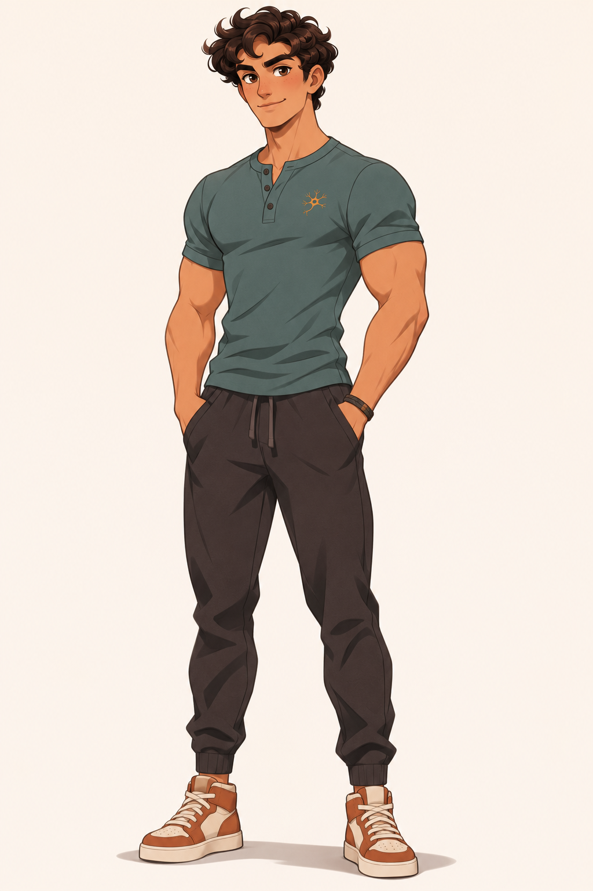
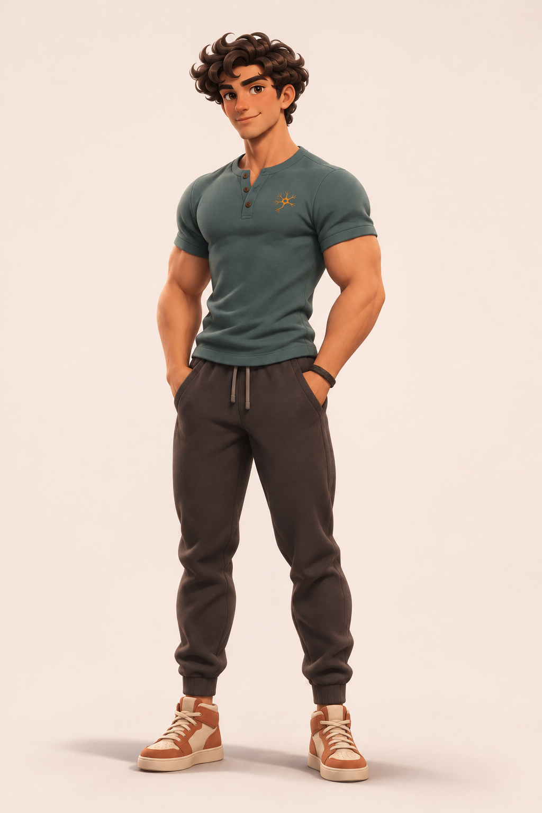

# YouTube character references

## Teo — locked, approved design

**Approved November 18, 2026.** These exact 2D and stylized 3D images define
Teo's canonical appearance for all future work. Preserve the design as shown.
Any redesign requires explicit user approval.

| Approved 2D reference | Approved 3D reference |
| --- | --- |
|  |  |

Read the [character lock and production prompts](characters/teo/CHARACTER_LOCK.md)
before creating any depiction of Teo. The images take precedence over text and
earlier character versions. Always supply the approved images as visual
references; use the original artwork when an identical image is needed.

- [Approved 2D PNG](characters/teo/images/teo-approved-2d.png)
- [Approved 3D PNG](characters/teo/images/teo-approved-3d.png)
- [Reference metadata and integrity hashes](characters/teo/reference-manifest.json)
- [Instructions for future agents](AGENTS.md)

Both PNGs are the unchanged approved originals at 1024 × 1536 pixels. The 3D
reference is an image; this repository does not yet contain a 3D model or rig.
Save future derivatives separately and keep these masters unchanged.

## Episode 1 — cinematic animation in production

[The Brain Team Challenge](episodes/episode-01/README.md) is intended as two
complete ten-minute animated films, using the approved 2D and stylized 3D looks.
The user selected the existing Kling O3 Pro scene performance as the benchmark:
Teo acts naturally within environments, walks, handles props, and speaks with
synchronized mouth movement and expressive delivery. See the
[cinematic production brief](episodes/episode-01/production/CINEMATIC_BRIEF.md).

Two 600-second local cutout drafts exist, but **the user rejected their visual
and animation approach**. They do not fulfill the cinematic requirement. Their
[reproduction instructions](episodes/episode-01/animation/README.md) and files
are retained as prototype history. The requested cinematic films are not yet
complete. The approved character masters remain unchanged.
