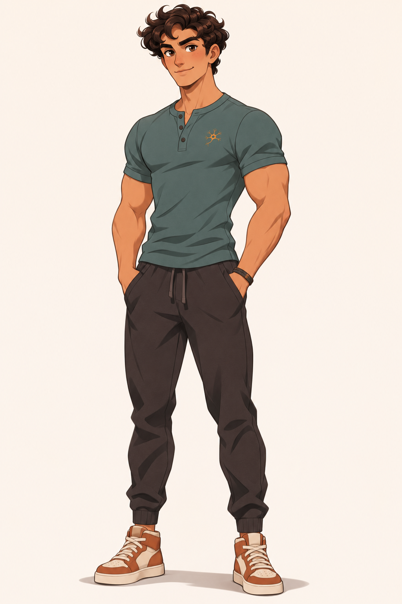
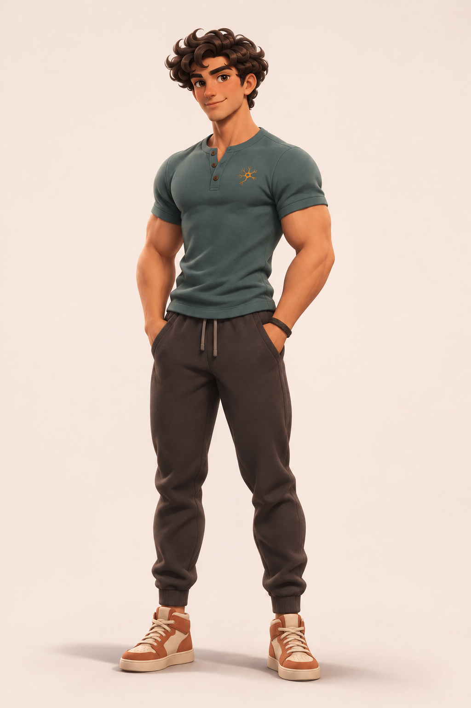

# Teo — approved character lock

**Status: LOCKED**  
**User approval date: 2026-11-18**

**Animation clarification, 2026-11-18:** The user explicitly approved natural
mouth movement while speaking, fluid walking and body movement, and expressive
prosody. Lock Teo's appearance, not his pose or performance. His facial
structure, identity, hair, build, clothes, and colors must stay consistent
while he animates.

For speech, synchronize mouth shapes and jaw movement to the actual dialogue
performance, including pauses, stress, rhythm, and emotion. Natural blinking,
eye movement, expressions, gestures, walking, and weight shifts are allowed.
The closed-mouth smile is his reference resting expression, not a requirement
to keep his mouth shut during dialogue. Avoid an exaggerated toothy grin or a
new permanent facial design. Use the spoken performance to guide animation;
adding a different recording afterward requires matching or retiming the lip
sync. Ordinary acting does not need a separate redesign approval.

These two exact images are Teo's canonical approved appearance. Every future illustration, render, model, animation, or production brief must consult the images before work begins. This lock supersedes all earlier Teo designs, descriptions, prompts, and reference pictures, including the original sombrero-and-poncho inspiration and earlier child-character design.

## Canonical references

### Approved 2D appearance

### Approved 3D appearance

The 3D image is a rendered visual reference only. It is not an editable 3D model, rig, scene, or animation asset.

## Authority and preservation

1. The exact approved images take precedence over this guide, any production prompt, and all earlier Teo material. Use the 2D image as the authority for 2D work and the 3D image as the authority for 3D work; consult both for identity consistency. Preserve each medium's approved treatment rather than averaging their differences into a new design.
2. Keep both original PNG files immutable. Do not overwrite, retouch, crop, resize, recompress, recolor, or regenerate them in place. Save any production derivatives separately and retain the originals unchanged.
3. Any redesign requires explicit user approval. This includes changes to identity, apparent age, face, skin tone, hair, physique, proportions, clothing, emblem, accessories, palette, or the approved visual style. A request for a new scene or pose authorizes only that requested variation, not a redesign.
4. A newly generated image is not a replacement canonical reference unless the user explicitly approves it as such. Keep prior approved originals even if a future revision is approved.
5. For exact reproduction, use the existing approved artwork. Fresh generation cannot guarantee pixel-identical results, even with the same prompt and reference images. Reference-conditioned generation is suitable for proposed new scenes or poses, subject to visual comparison against these originals.
6. Do not invent canonical details that these images do not establish, including exact age, height, measurements, color hex codes, unseen back details, or hidden construction. Treat any necessary unseen details as provisional and obtain explicit user approval before adding them to the locked design.

## Movement and animation

**Added 2026-11-18 at the user's direction.** The lock fixes Teo's design, not his motion. He should move with natural fluidity.

- Allowed, with no further approval: his mouth moving when he speaks, blinking, eye direction, changing expressions, head turns, gestures, walking, running, reaching, kneeling, sitting, and his hair and clothes reacting to movement.
- Not allowed without explicit approval: any change to his face structure, apparent age, skin tone, hair shape, build, proportions, clothing, emblem, accessories, or palette, whether between shots or within a single clip. No morphing or restyling mid-motion.
- Expressions may show teeth only as far as natural speech requires; his resting look stays the approved closed-mouth smile.
- Animating from an approved image means using a copy as the starting frame. The approved PNG masters themselves are never overwritten or altered.
- Include this rule in every motion or video prompt, and compare the first and last frame of each clip against the approved references.
- Synchronize visible speech to the actual voice performance, including pauses, stress, rhythm, and emotion. Replacing a voice later requires matching or retiming the mouth animation.

## Visible design to preserve

- **Identity and proportions:** A young-adult male character with a warm, approachable expression; an athletic, muscular build; broad shoulders and chest; a tapered waist; defined upper arms and forearms; and long-legged, natural stylized proportions. Match the images' actual silhouette and head-to-body relationship.
- **Face:** Warm tan skin; large brown eyes; thick dark eyebrows; a defined jaw and chin; a straight, softly modeled nose; a clean-shaven face; subtle freckles across the nose and upper cheeks; and a small, relaxed closed-mouth smile with no visible teeth. Preserve the approved facial structure rather than substituting a generic handsome face.
- **Hair:** Dense, voluminous dark-brown curls with warm brown highlights, a loose curl falling forward over the forehead, and a rounded, irregular curled silhouette around the crown and sides. No hat or headwear.
- **Shirt:** A fitted, muted gray-green/teal short-sleeve henley, worn untucked, with a short three-button placket and cuffed sleeve edges. A small ochre/gold branching neuron emblem sits on Teo's left chest (the viewer's right). Preserve its size, placement, and shape from the relevant reference.
- **Trousers:** Dark charcoal-brown drawstring joggers with side pockets, two visible drawstring ends hanging at the front, tapered legs, fabric folds, and ribbed ankle cuffs. Match the reference drawstring arrangement rather than inventing a bow.
- **Shoes:** Rust/terracotta and cream high-top sneakers with cream laces, cream toe and side panels, contrasting rust overlays, and thick cream soles. Match the approved panel layout and proportions.
- **Accessory:** A narrow dark wristband on Teo's left wrist (the viewer's right). Do not add extra jewelry, goggles, a visor, a jacket, or other accessories.
- **Palette:** Restrained, muted clothing colors; warm skin and dark-brown hair; a small warm gold emblem; and subdued rust accents on the shoes. Match the images directly; do not increase saturation or replace the palette with bright teal, yellow, or orange.
- **Reference presentation:** Full body, both shoes visible, feet comfortably apart, hands in trouser pockets, and a relaxed slight turn of the head and torso. The background is pale warm cream with a soft grounding shadow. Preserve this presentation unless the user requests a different scene or pose.
- **2D treatment:** Clean dark contours, controlled line weight, crisp cel-shaded forms, restrained gradients, and drawn facial and fabric details. Preserve the original illustration's character and anatomy.
- **3D treatment:** A polished stylized character render with softly modeled features, sculpted curls, subtle skin and fabric texture, matte materials, and gentle warm studio lighting. Preserve the rendered reference's identity and proportions; do not turn it into photorealism or a different cartoon design.

## Reusable production prompts

Before using either template, attach the appropriate approved PNG as an actual image reference. Also provide the counterpart image when the tool supports multiple references. A text-only prompt is insufficient to enforce this lock. Replace the bracketed fields with the user's requested variation; leave them as “same as the approved reference” when no variation was requested.

### 2D prompt

> Create a new 2D illustration of the exact approved Teo shown in the attached `teo-approved-2d.png`. This image is the authoritative character reference; the attached 3D counterpart, if supplied, is a secondary identity check. Preserve Teo's exact approved facial identity, apparent age, warm tan skin, brown eyes, thick eyebrows, dark-brown curly hairstyle and silhouette, clean-shaven face, closed-mouth resting smile, muscular athletic build, and body proportions. Natural speaking mouth shapes, expressions, and fluid movement are allowed; synchronize speech animation to the actual voice and its prosody without altering his facial structure. Preserve his fitted muted gray-green/teal three-button short-sleeve henley, small gold neuron emblem on his left chest, charcoal-brown drawstring cuffed joggers, rust-and-cream high-top sneakers, and dark left-wrist band. Match the reference's palette, clothing construction, accessory placement, clean outlines, and cel shading. User-requested scene: [SCENE]. User-requested pose: [POSE]. Change only those explicitly requested scene and pose elements. Preserve all other approved design choices. For a full-body composition, keep the complete hair silhouette and both shoes inside the frame. Consult the attached artwork throughout; do not reinterpret, beautify, age, recolor, exaggerate the muscles, change the clothes, or revert to any earlier Teo design. This is a production variation, not a new canonical design.

### 3D prompt

> Create a new stylized 3D rendered image of the exact approved Teo shown in the attached `teo-approved-3d.png`. This image is the authoritative character reference; the attached 2D counterpart, if supplied, is a secondary identity check. Preserve Teo's exact approved facial identity, apparent age, warm tan skin, brown eyes, thick eyebrows, dark-brown curly hairstyle and silhouette, clean-shaven face, closed-mouth resting smile, muscular athletic build, and body proportions. Natural speaking mouth shapes, expressions, and fluid movement are allowed; synchronize speech animation to the actual voice and its prosody without altering his facial structure. Preserve his fitted muted gray-green/teal three-button short-sleeve henley, small gold neuron emblem on his left chest, charcoal-brown drawstring cuffed joggers, rust-and-cream high-top sneakers, and dark left-wrist band. Match the reference's palette, clothing construction, accessory placement, sculpted curls, soft stylized facial modeling, matte materials, and subtle fabric texture. User-requested scene: [SCENE]. User-requested pose: [POSE]. Change only those explicitly requested scene and pose elements. Preserve all other approved design choices. For a full-body composition, keep the complete hair silhouette and both shoes inside the frame. Consult the attached artwork throughout; do not reinterpret, beautify, age, recolor, exaggerate the muscles, change the clothes, make the character photorealistic, or revert to any earlier Teo design. Deliver a rendered image; do not imply that a model or rig has been created. This is a production variation, not a new canonical design.

## Review before delivery

1. Read this guide and visually inspect both approved PNGs.
2. From this guide's directory (`characters/teo/` in the repository), run `sha256sum -c SHA256SUMS` (or `shasum -a 256 -c SHA256SUMS` on macOS). Both images must report `OK`. A mismatch means the bytes differ from the approved originals; recover the originals before work rather than updating the hashes to accept the changed files.
3. Attach the relevant PNG as an image reference and use the matching prompt template. Save the result under a new filename outside the original reference paths.
4. Compare every proposed derivative directly with both approved images, prioritizing its own medium's reference. Check face and hair first, then silhouette and build, skin tone and palette, shirt and emblem, trousers, sneakers, and wristband. Correct unintended differences before delivery.
5. If a requested result requires redesign, preserve the originals and obtain explicit user approval for that change. Keep unapproved variants clearly separate from the canonical references.
